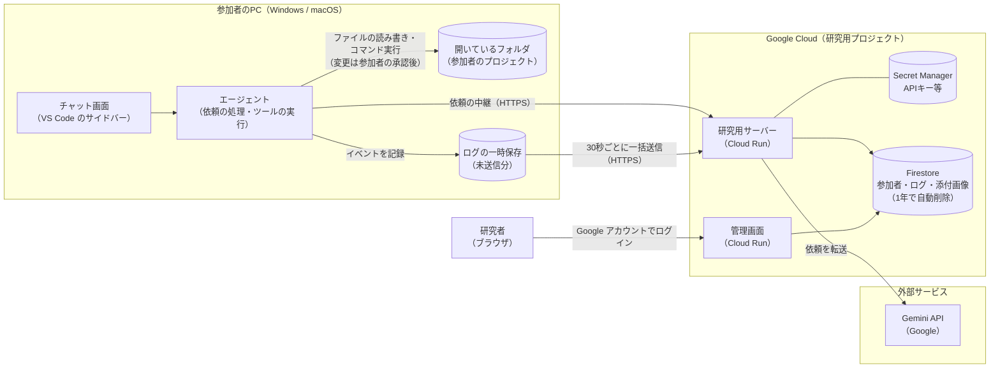
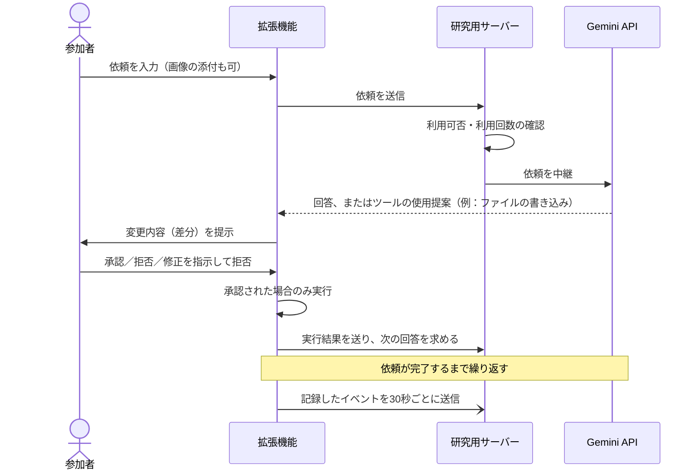

# 研究用コーディングエージェントとログ収集基盤の概要

- 研究題目：AIコーディングエージェントと人間の相互作用の展開と変化
- 作成：鈴木啓太
- 作成日：2026-11-02
- 対象：指導教員への報告資料

---

## 1. 研究目的

### 1.1 目的

AIコーディングエージェントと人間の相互作用が、1つの依頼の中でどのように展開し、利用期間を通じてどのように変化するのかを明らかにする。

### 1.2 達成条件

1. **相互作用の構成要素が明らか**：人間とAIがどのような行動を取っているのかを分類・説明できる
2. **エピソード内の展開が明らか**：それらの行動がどのような順序・組み合わせで発生するのかを説明できる
3. **利用期間を通じた変化が明らか**：利用期間の経過に伴い、相互作用および成果物の作成過程において何がどのように変化したのか、またその変化をどのような構成要素によって捉えられるのかを説明できる

### 1.3 研究設問（RQ）

| RQ | 内容 | 達成条件 |
|---|---|---|
| RQ1 | AIコーディングエージェントと人間の相互作用は、どのような行動によって構成されているか | ① |
| RQ2 | 1つの依頼の中で、人間とAIの行動はどのような順序・組み合わせで発生するか | ② |
| RQ3 | エピソード内には、どのような代表的な相互作用パターンが存在するか | ② |
| RQ4 | 利用期間の経過に伴い、相互作用および成果物の作成過程のどのような側面に変化が見られるか | ③ |
| RQ5 | それらの側面は、利用期間の経過に伴い、どのように変化するか | ③ |
| RQ6 | 観測された変化は、どのような構成要素によって捉えられるか | ③ |
| RQ7 | 利用期間の経過に伴い、エピソード内の相互作用パターンはどのように変化するか | ③ |

### 1.4 本システムを開発する理由

RQ に答えるには、参加者が普段の開発の中でエージェントをどう使ったかを、行動単位で継続的に記録する必要がある。市販のエージェント（Claude Code、GitHub Copilot など）では、人間が AI の提案を承認したか、拒否したか、修正を指示したかといった細かな行動を、研究に必要な粒度で取り出すことが難しい。

そこで、Gemini API を使うコーディングエージェントを VS Code 拡張機能として自作し、研究室メンバーに配布する。エージェントの操作と同時に、研究に必要なイベントを自動で記録する。参加者がログを提出する作業は不要である。

あわせて、有料のAI開発ツールを契約している研究室メンバーは少ないため、研究室共通のAI開発環境を提供することも副次的な目的とする。

---

## 2. システムのアーキテクチャ

### 2.1 全体構成

| 構成要素 | 役割 |
|---|---|
| VS Code 拡張機能 | チャット画面とエージェント本体。ファイルの読み書きやコマンドの実行を道具（ツール）として使い、依頼を処理する。ファイルの変更とコマンドの実行は、必ず参加者の承認を得てから行う。操作のたびにイベントを記録する |
| 研究用サーバー | 拡張機能と Gemini API の間を中継する。参加者の認証、利用してよいかの判定、利用回数の上限管理、ログの受信と保存を行う |
| 管理画面 | 研究者が使う画面。参加者の登録（招待コード発行）、利用の停止・再開、ログの閲覧、CSV 出力、設定変更を行う |
| Firestore | 参加者情報（研究用IDのみ）、イベントログ、添付画像、設定を保存するデータベース。ログと画像は受信から1年で自動的に削除される |
| Secret Manager | Gemini の APIキーなどの秘密情報を保管する |

### 2.2 設計上のポイント

- **APIキーを参加者のPCに置かない**：拡張機能は Gemini API を直接呼ばず、必ず研究用サーバーを経由する。APIキーの抜き取りや流用を防ぐためである
- **研究者がいつでも利用を止められる**：サーバーが依頼のたびに利用可否を判定するため、参加者ごと、または全体の利用を管理画面から即座に停止できる
- **利用回数の管理**：1つの APIキーを全員で共有するため、全体と参加者ごとの利用回数をサーバーで数え、Gemini の無料枠を超えないように上限を設ける
- **オフラインでも記録が欠けない**：ログはいったん参加者のPC内に保存し、30秒ごとにまとめて送る。送信に失敗しても保持して再送し、サーバー側で重複を取り除く
- **費用**：Google Cloud と Gemini API の無料枠内で運用する

### 2.3 1回の依頼の流れ

1つの依頼の中で、AI の提案と人間の判断（承認・拒否・修正指示・中断）が交互に起こる。この一連のやり取りを、イベントとして記録する。

### 2.4 停止・中断の仕組み

| 操作する人 | 操作 | 内容 |
|---|---|---|
| 研究者 | 参加者の停止 | 特定の参加者の利用を止める |
| 研究者 | 全体の停止 | 全員の利用を止める（障害時など） |
| 参加者 | ログ収集の一時停止 | 私用の作業や第三者の情報を扱う作業のときに使う。一時停止中は記録を行わず、エージェントも使えない |
| 参加者 | 同意の撤回 | 利用を停止する。撤回時に、それまでのデータの削除を依頼できる |

---

## 3. 開発環境

### 3.1 使用技術

| 区分 | 使用技術 |
|---|---|
| 開発言語 | TypeScript（拡張機能・サーバーとも） |
| 実行環境 | Node.js 20 |
| 拡張機能 | VS Code 拡張機能 API（VS Code 1.90 以降）、Webview（チャット画面） |
| サーバー | Hono（Web フレームワーク）、Docker コンテナ |
| AI モデル | Google Gemini API（`gemini-3.1-flash-lite`。無料枠で利用） |
| データベース | Google Cloud Firestore |
| 実行基盤 | Google Cloud Run（東京リージョン `asia-northeast1`） |
| 秘密情報の管理 | Google Cloud Secret Manager |
| 管理画面の認証 | Google アカウントでのログイン（OAuth 2.0）。許可した研究者のアカウントのみ利用可 |
| テスト・品質管理 | Vitest（自動テスト）、ESLint（静的解析） |
| ソースコード管理 | GitHub（変更は Pull Request でレビューしてから反映） |
| 開発支援 | Claude Code、Devin（AIコーディングエージェント） |

### 3.2 開発・動作環境

| 項目 | 内容 |
|---|---|
| 開発PC | Windows 11、VS Code |
| 参加者の動作環境 | Windows／macOS の VS Code 1.90 以降。Unity・Processing のプロジェクトも VS Code で開いて利用できる |
| 配布方法 | ZIP ファイル（拡張機能本体、インストーラー、参加者向け手順書）。インストーラーをダブルクリックするだけで導入でき、研究用サーバーの接続先は埋め込み済み |

### 3.3 Gemini API の利用上限（運用設定）

1つの APIキーを全参加者で共有し、Gemini の無料枠（1分15回、1日500回）の内側に上限を設定している。想定参加者数は10人。

| 項目 | 設定値 |
|---|---|
| 全体の1分あたりの上限 | 10 回 |
| 全体の1日あたりの上限 | 450 回 |
| 1人1日あたりの上限 | 50 回 |
| 1人1日あたりのトークン上限 | 200 万トークン |

1日の区切りは太平洋時間の0時（日本時間の16時または17時）で、Gemini の無料枠がリセットされる時刻に合わせている。エージェントは1つの依頼で Gemini を3〜6回呼ぶため、全体で1日およそ100件の依頼に相当する。

---

## 4. 収集するデータ

参加者は研究用ID（例：`P001`）で管理し、氏名はシステムに保存しない。研究用IDと氏名の対応表は、研究者がシステムの外で別に保管する（仮名化）。

### 4.1 すべてのイベントに共通する項目

| 項目 | 内容 |
|---|---|
| イベントID | 各イベントに付ける一意のID（重複の除去に使う） |
| 研究用ID | 参加者の研究用ID |
| セッションID | VS Code を起動するごとに変わるID |
| 会話ID | チャットの会話ごとのID（「新しい会話」で変わる） |
| ターン番号 | 会話の中で、人が入力した回数の通し番号 |
| 種別 | イベントの種類（4.2） |
| 発生時刻 | 参加者のPCで発生した時刻 |
| 受信時刻 | サーバーが受信した時刻 |
| 環境情報 | 拡張機能のバージョン、VS Code のバージョン、OS の種類（Windows／macOS など） |

### 4.2 イベントの種類と記録する項目

| 種別 | 記録するタイミング | 記録する項目 | 本文（同意③がある場合のみ） |
|---|---|---|---|
| `session_start` / `session_end` | VS Code の起動・終了 | フォルダを開いているか | — |
| `conversation_start` | 新しい会話の開始 | — | — |
| `user_prompt` | 人の入力（依頼・追加の質問など） | 文字数、添付画像の枚数、直前の AI の回答からの経過時間 | 入力した文章、添付画像 |
| `model_response` | AI の1回の回答の完了 | 文字数、回答の種類（文章／ツールの使用提案／両方）、ツールの使用提案の数、所要時間、入力・出力のトークン数、モデル名 | AI の回答の文章 |
| `tool_call` | AI がツールの使用を提案 | ツール名、承認が必要か、対象ファイルの拡張子 | — |
| `tool_decision` | 人がツールの使用を判断 | 判断（承認／拒否／修正を指示して拒否／自動承認）、判断までにかかった時間 | 修正指示の文章 |
| `tool_result` | ツールの実行完了 | ツール名、成功したか、所要時間、追加・削除した行数、対象ファイルの拡張子、コマンドの終了コード | — |
| `user_cancel` | 人が処理を中止 | 中止した時点の状態 | — |
| `error` | エラー・上限到達・停止による拒否 | エラーの種類、HTTP ステータス | — |
| `consent_changed` | 同意・撤回 | 変更後の同意の状態 | — |
| `collection_paused` / `collection_resumed` | ログ収集の一時停止・再開 | — | — |

エージェントが使えるツールは、ファイルの読み込み、ファイル一覧、文字列検索、ファイルの部分編集、ファイルの書き込み、コマンド実行の6種類である。このうち、ファイルの編集・書き込みとコマンド実行は参加者の承認が必要である。

### 4.3 添付画像

参加者が依頼に添付した画像（エラー画面のスクリーンショットなど）は、同意③がある場合のみ保存する。1回の依頼につき最大4枚で、送信前に長辺1568ピクセル以下に縮小する。イベントとは別に保存し、イベント側には画像のIDを残す。研究者は管理画面から画像を確認できる。

### 4.4 収集しないもの

- エージェントが読み書きしたファイルの内容、ファイル名、フォルダのパス（ファイルの拡張子のみ記録する）
- 検索した文字列
- 実行したコマンドの文字列と、その出力
- パスワードや APIキーなどの認証情報、環境変数
- 参加者の氏名・メールアドレス

なお、`.env` などの秘密情報を含みやすいファイルは、エージェントが読み書きできないようにしている。

### 4.5 CSV で出力できる列

研究者は管理画面で、参加者・期間・種別を絞り込み、必要な列だけを選んで CSV に出力できる。本文などの大きな列は、初期状態では出力しない。

| 列 | 内容 | 初期状態 |
|---|---|---|
| イベントID、研究用ID、セッションID、会話ID、ターン番号、種別、発生時刻 | 4.1 の共通項目 | 出力する |
| 受信時刻 | サーバーの受信時刻 | 出力しない |
| ツール名、承認判断、判断時間、成否、所要時間、文字数、出力タイプ、追加行数、削除行数、終了コード | 4.2 の各イベントの項目 | 出力する |
| ファイル拡張子、入力トークン、出力トークン、モデル、環境情報、payload（記録項目の全体を JSON で） | 4.2 の各イベントの項目 | 出力しない |
| 本文、修正指示の本文、添付画像ID | 同意③に基づく本文 | 出力しない |

### 4.6 研究設問との対応

| 分析の観点 | 使うデータ |
|---|---|
| ターン | `user_prompt` → `model_response`／`tool_call` → 次の `user_prompt` または `tool_decision` |
| エピソード（1つの依頼） | 会話ID と、操作の時間の間隔から分析時に判定する |
| 人間の行動（RQ1〜3） | `tool_decision` の判断の種類、`user_cancel`、`user_prompt` の本文（修正指示・追加質問などに分類） |
| 成果物の作成過程（RQ4〜7） | `tool_result` の変更行数・成否・拡張子・コマンドの終了コード、それらの期間による推移 |

---

## 5. 同意項目

拡張機能を初めて使うときに、次の同意画面を表示する。**①〜③のすべてに同意した場合のみ、エージェントを利用できる。** 同意する前は、ログを一切送信しない。

### 5.1 同意画面の文言

> **研究へのご協力について**
>
> このエージェントは卒業研究のための実験環境です。①〜③のすべてに同意いただいた場合に利用できます。
>
> **① 環境の利用と Gemini への送信**
> 入力した指示・添付した画像と、エージェントが読んだファイルの内容・コマンドの出力が、研究用サーバーを経由して Google の Gemini API に送られることに同意します。無料枠の API を使うため、送信内容は Google のサービス改善に利用されることがあります。個人情報や秘密情報を含むファイルや画像は扱わないでください。
>
> **② 操作ログ（メタデータ）の提供**
> 操作の種類・時刻・ツール名・承認／拒否・成否・変更行数・ファイルの拡張子などを研究者に提供することに同意します。ファイルの内容・ファイル名・パス・コマンドの文字列や出力は収集しません。
>
> **③ 本文・添付画像の提供**
> あなたの入力（指示）・AI の回答・拒否時の修正指示の本文と、依頼に添付した画像（スクリーンショットなど）を研究者に提供することに同意します。添付した画像も研究用ログとして収集します。
>
> ・収集したデータは研究用ID（氏名ではありません）で管理し、受信から1年後に自動で削除します。
> ・ログ収集は画面上部の「収集を一時停止」でいつでも止められます。一時停止中はエージェントも使えなくなり、「収集を再開」を押すと再び使えます。
> ・同意はいつでも撤回できます。撤回すると利用は停止されます（再開には研究者への連絡が必要です）。撤回時にこれまでのデータの削除を依頼することもできます。

### 5.2 同意に関する取り扱い

| 項目 | 取り扱い |
|---|---|
| 同意の単位 | ①環境の利用と外部送信、②操作ログ、③本文・添付画像 の3項目に分けて説明し、それぞれにチェックを付けてもらう |
| 利用の条件 | 3項目すべての同意を利用の条件とする |
| 二重の確認 | 拡張機能に加えて、サーバー側でも同意の状態を確認する。②に同意していない参加者のログは保存せず、③に同意していない参加者の本文と画像は保存しない |
| 一時停止 | 参加者はいつでもログ収集を一時停止できる。一時停止中は記録を行わず、エージェントも使えない |
| 撤回 | 参加者はいつでも同意を撤回できる。撤回するとエージェントの利用は停止される |
| データの削除 | 撤回時に削除を依頼できる。研究者が管理画面から、その参加者の情報・ログ・添付画像をすべて削除する |
| 保存期間 | 受信から1年。期間を過ぎたログと画像は自動で削除される |

### 5.3 研究倫理上の留意点

- 研究室の教員・研究者が、個々の参加者の利用内容を日常の評価や指導に使うことはしない。報告は原則として集計値で行う
- 同意しない場合や撤回した場合は、このエージェントを利用できない。研究室共通の開発環境としての利用と研究への協力を一体にしているため、この点は倫理手続の書類を作成する際に説明する
- 無料枠の Gemini API を使うため、送信内容が Google のサービス改善に利用されうることを、同意画面①で明示している
