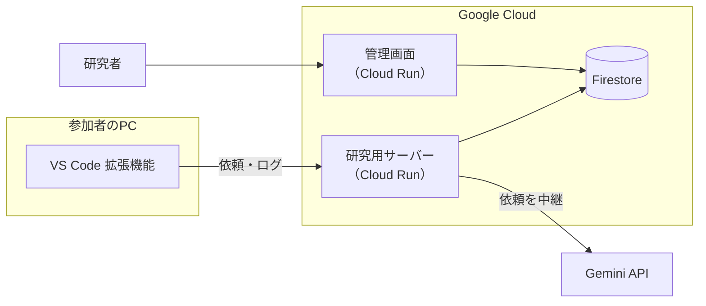
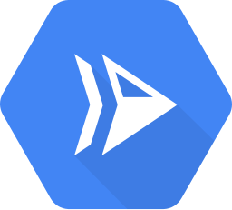
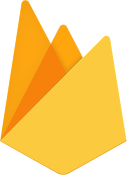

# Research-LLM

卒業研究のための開発リポジトリ。自作のコーディングエージェント（VS Code 拡張機能）を研究室メンバーに配布し、エージェントと人間のやり取りを本人の同意のもとで記録する。

## ステータス

| 段階 | 状態 | 日付 |
|---|---|---|
| 研究設計 | 完了 | 2026-10-19 |
| 要件定義 | 完了 | 2026-10-26 |
| 実装・本番デプロイ | 完了 | 2026-10-26 |
| 配布テスト・修正 | 完了 | 2026-11-09 |
| 参加者への配布 | 進行中 | 2026-11-09〜 |
| データ収集 | 未着手 | — |
| 分析・論文執筆 | 未着手 | — |

## 卒論テーマ

AIコーディングエージェントと人間の相互作用が、1つの依頼の中でどう展開し、利用期間を通じてどう変化するか

## 研究目的

AIコーディングエージェントと人間の相互作用が、1つの依頼の中でどのように展開し、利用期間を通じてどのように変化するのかを明らかにする。

## システム構成

| 構成要素 | 役割 | 使用技術 |
|---|---|---|
| VS Code 拡張機能 | チャット画面・エージェント本体。操作イベントを記録してサーバーに送る | TypeScript、VS Code 拡張機能 API |
| 研究用サーバー | Gemini API の中継、参加者認証、利用回数の管理、ログの保存 | TypeScript／Node.js 20、Hono、Cloud Run、Firestore、Secret Manager、Gemini API |
| 管理画面 | 参加者の登録・停止、ログ閲覧、CSV 出力 | TypeScript、Hono、Cloud Run、Google アカウント認証 |
| デプロイ・配布 | Cloud Run へのデプロイ、配布 ZIP の作成 | gcloud CLI、シェルスクリプト |

## アーキテクチャ



<table>
  <tr>
    <td align="center"><br>Google Cloud</td>
    <td align="center"><br>Cloud Run</td>
    <td align="center"><br>Firestore</td>
    <td align="center"><br>Gemini API</td>
  </tr>
</table>

## フォルダ構成

```
Research-LLM/
├── 00_context/     研究者が用意した前提資料
├── 01_docs/        要件定義書・運用手順書などのドキュメント
├── 02_scripts/
│   ├── server/     研究用サーバー・管理画面
│   ├── extension/  VS Code 拡張機能
│   └── deploy/     デプロイ・配布スクリプト
├── .devin/         Devin の設定
└── .github/        PR テンプレート
```

## アプリURL

| 用途 | URL |
|---|---|
| 管理画面 | https://research-llm-ugljnvagka-an.a.run.app/admin |
| 研究用サーバー | https://research-llm-ugljnvagka-an.a.run.app |
