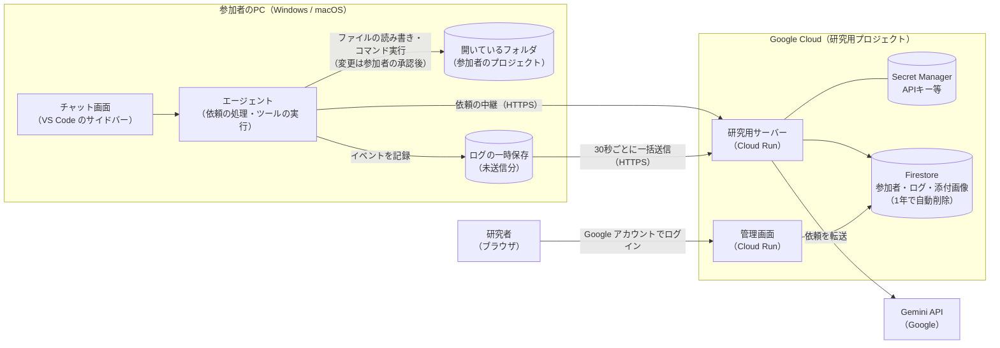
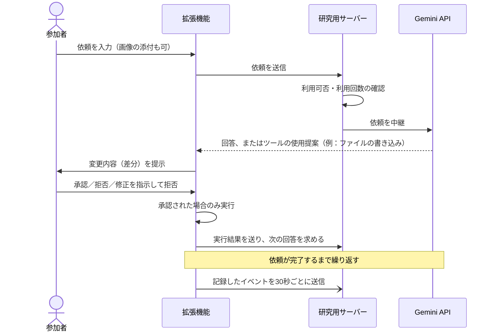

# Research-LLM

卒業研究のための開発リポジトリです。Gemini API を使うコーディングエージェントを VS Code 拡張機能として自作して研究室メンバーに配布し、エージェントと人間のやり取りを、本人の同意のもとで自動的に記録します。

## ステータス

**現在：開発完了 → 参加者への配布段階**（2026-11-09 時点）

| 段階 | 状態 | 日付 | 内容 |
|---|---|---|---|
| 研究設計 | ✅ 完了 | 2026-10-19 | 研究目的・達成条件・RQ1〜RQ7 を整理（[研究設計整理.md](00_context/研究設計整理.md)） |
| 要件定義 | ✅ 完了 | 2026-10-26 | [要件定義書.md](01_docs/要件定義書.md)（PR #4） |
| 実装 | ✅ 完了 | 2026-10-26 | 研究用サーバー・管理画面・VS Code 拡張機能・デプロイスクリプト（PR #5） |
| 本番デプロイ | ✅ 完了 | 2026-10-26 | Cloud Run・Firestore・Secret Manager に構築。最新の更新は 2026-11-09 |
| 配布テスト・修正 | ✅ 完了 | 2026-11-02〜11-09 | インストーラーの不具合修正、画像添付、利用回数のリセット時刻表示、macOS 向け配布 ZIP の修正（PR #6〜#13） |
| 教授への説明資料 | ✅ 完了 | 2026-11-02 | [教授提出資料.md](01_docs/教授提出資料.md)（PR #11） |
| 参加者への配布 | 🔄 進行中 | 2026-11-09〜 | 配布 ZIP（拡張機能 0.1.1）を研究室メンバーに配布 |
| データ収集 | ⏳ 未着手 | — | 開始時期は研究者が判断する |
| 分析・論文執筆 | ⏳ 未着手 | — | 収集したログで RQ1〜RQ7 を分析する |

| 項目 | 現在の値 |
|---|---|
| 拡張機能のバージョン | 0.1.1 |
| サーバーのリビジョン | `research-llm-00006-f77` |
| 参加者への配布・実データの収集開始 | 研究者が判断して行う（エージェントは独断で行わない） |

## 卒論テーマ

**AIコーディングエージェントと人間の相互作用が、1つの依頼の中でどう展開し、利用期間を通じてどう変化するか**

### 研究目的

AIコーディングエージェントと人間の相互作用が、1つの依頼の中でどのように展開し、利用期間を通じてどのように変化するのかを明らかにする。

### 研究設問（RQ）

| 達成条件 | RQ |
|---|---|
| ① 相互作用の構成要素が明らか | **RQ1** 相互作用は、どのような行動によって構成されているか |
| ② エピソード内の展開が明らか | **RQ2** 1つの依頼の中で、人間とAIの行動はどのような順序・組み合わせで発生するか<br>**RQ3** エピソード内には、どのような代表的な相互作用パターンが存在するか |
| ③ 利用期間を通じた変化が明らか | **RQ4** 利用期間の経過に伴い、相互作用および成果物の作成過程のどのような側面に変化が見られるか<br>**RQ5** それらの側面は、どのように変化するか<br>**RQ6** 観測された変化は、どのような構成要素によって捉えられるか<br>**RQ7** エピソード内の相互作用パターンはどのように変化するか |

正本は [00_context/研究設計整理.md](00_context/研究設計整理.md)。

### このシステムを作る理由

RQ に答えるには、参加者が普段の開発（VS Code／Unity／Processing）でエージェントをどう使ったかを、行動単位で継続的に記録する必要がある。市販のエージェント（Claude Code、GitHub Copilot など）では、AI の提案を**承認したか・拒否したか・修正を指示したか**といった行動を、研究に必要な粒度で取り出しにくい。そのため、エージェントを自作し、操作と同時にイベントを記録する。参加者がログを提出する作業は不要。

## 構成

| 構成要素 | 内容 | 場所 |
|---|---|---|
| VS Code 拡張機能 | チャット画面とエージェント本体。ファイルの読み書き・検索・コマンド実行をツールとして使い、依頼を処理する。ファイルの変更とコマンドの実行は参加者の承認後に行う。操作イベントを記録して30秒ごとに送信する | `02_scripts/extension/` |
| 研究用サーバー | Gemini API の中継（APIキーはサーバーのみが保持）、参加者認証、利用可否の判定、利用回数の上限管理、ログの受信・保存 | `02_scripts/server/` |
| 管理画面 | 参加者の登録（招待コード発行）・停止・再開・削除、ログ閲覧、CSV 出力、設定変更。Google アカウントでログイン | `02_scripts/server/src/admin/` |
| デプロイ・配布 | Cloud Run へのデプロイスクリプト、配布 ZIP（`.vsix`＋Windows/macOS インストーラー＋参加者向け手順書）の作成スクリプト | `02_scripts/deploy/` |

| 区分 | 使用しているもの |
|---|---|
| 実行基盤 | Google Cloud Run（`asia-northeast1`、最大1インスタンス）、Firestore（ログは受信から1年で自動削除）、Secret Manager |
| AI | Gemini API（無料枠） |
| 言語・ライブラリ | TypeScript／Node.js 20 以上、Hono（サーバー）、VS Code 拡張機能 API（1.90 以降）、esbuild |
| テスト・品質 | Vitest、ESLint |
| 参加者の環境 | Windows／macOS の VS Code |

## アーキテクチャ

### 全体構成



### 1回の依頼の流れ



1つの依頼の中で、AI の提案と人間の判断（承認・拒否・修正指示・中断）が交互に起こる。この一連のやり取りをイベントとして記録し、RQ の分析に使う。

### 設計上のポイント

- **APIキーを参加者のPCに置かない**：拡張機能は Gemini API を直接呼ばず、必ず研究用サーバーを経由する
- **研究者がいつでも利用を止められる**：サーバーが依頼のたびに利用可否を判定する。参加者ごと、または全体の利用を管理画面から即座に停止できる
- **利用回数の管理**：1つの APIキーを全員で共有するため、全体と参加者ごとの利用回数をサーバーで数え、Gemini の無料枠を超えないようにする
- **オフラインでも記録が欠けない**：ログはいったん参加者のPC内に保存し、30秒ごとにまとめて送る。送信に失敗しても保持して再送し、サーバー側で重複を取り除く
- **参加者が記録を止められる**：ログ収集の一時停止（一時停止中はエージェントも使えない）と、同意の撤回がいつでもできる
- **費用**：Google Cloud と Gemini API の無料枠内で運用する

## フォルダ構成

```
Research-LLM/
├── 00_context/                 研究者が用意した前提資料（エージェントは編集しない）
│   ├── 研究設計整理.md          研究目的・達成条件・RQ1〜RQ7（正本）
│   ├── 研究コンテキスト.md      想定構成・データ収集方針・製品選定の制約
│   └── 旧RQ分析方法案-v1.md     旧RQ体系での分析方法案（参考）
├── 01_docs/                    作成したドキュメント
│   ├── 要件定義書.md
│   ├── 教授提出資料.md
│   ├── 運用手順書.md            研究者向け
│   ├── 参加者向け手順書.md      参加者向け（配布 ZIP にも同梱）
│   └── 修正内容_*.md            不具合の調査・修正の記録
├── 02_scripts/
│   ├── server/                 研究用サーバー・管理画面（Cloud Run）
│   │   ├── src/
│   │   │   ├── index.ts         起動処理
│   │   │   ├── app.ts           ルーティングのまとめ
│   │   │   ├── api.ts           参加者用 API（認証・状態・同意・チャット中継・ログ受信）
│   │   │   ├── access.ts        利用可否の判定
│   │   │   ├── events.ts        受信したイベントの検証・整形
│   │   │   ├── llm.ts           Gemini API の呼び出し（mockLlm.ts はローカル用のモック）
│   │   │   ├── admin/           管理画面（ログイン・参加者管理・ログ閲覧・CSV 出力）
│   │   │   └── store/           データの保存（Firestore／ローカル用のメモリ DB）
│   │   ├── test/
│   │   └── Dockerfile
│   ├── extension/              VS Code 拡張機能
│   │   ├── src/
│   │   │   ├── extension.ts     起動処理・画面とのやり取り
│   │   │   ├── agent.ts         エージェント本体（依頼の処理・ツール呼び出しのループ）
│   │   │   ├── tools.ts         ツール（ファイルの読み書き・検索・コマンド実行）
│   │   │   ├── denylist.ts      読み書きを禁止するファイル（.env など）
│   │   │   ├── eventLogger.ts   イベントの記録・一時保存・送信
│   │   │   └── apiClient.ts     研究用サーバーとの通信
│   │   ├── media/              チャット画面（HTML から読み込む JS・CSS）
│   │   └── test/
│   └── deploy/
│       ├── deploy.sh            GCP へのデプロイ
│       ├── build-distribution.sh 配布 ZIP の作成
│       ├── make-zip.mjs         ZIP の書き出し（macOS 用の実行権限・日本語ファイル名に対応）
│       ├── installer/          参加者用インストーラー（Windows: install.cmd／install.ps1、macOS: install.command）
│       └── out/                作成した配布 ZIP（Git 管理外）
├── .devin/                     Devin の環境定義
├── .github/                    PR テンプレート
├── AGENTS.md                   作業ルール・開発コマンド
└── README.md
```

開発コマンド（依存関係のインストール・Lint・テスト・ビルド・ローカル起動）は [AGENTS.md](AGENTS.md) を参照。
